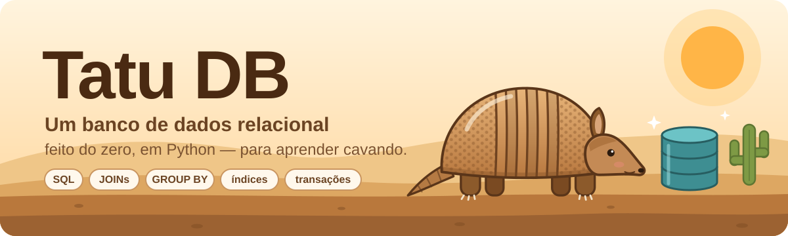
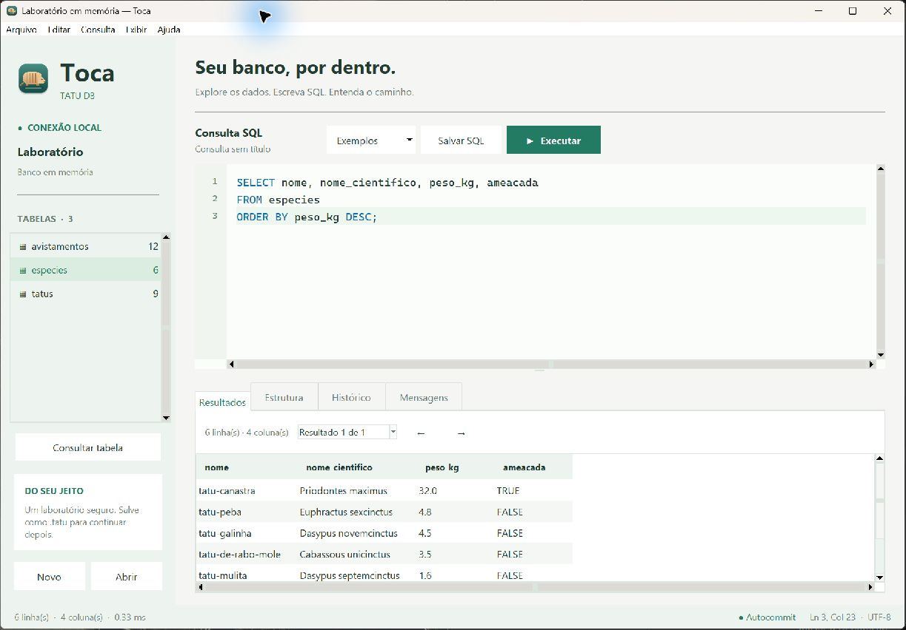
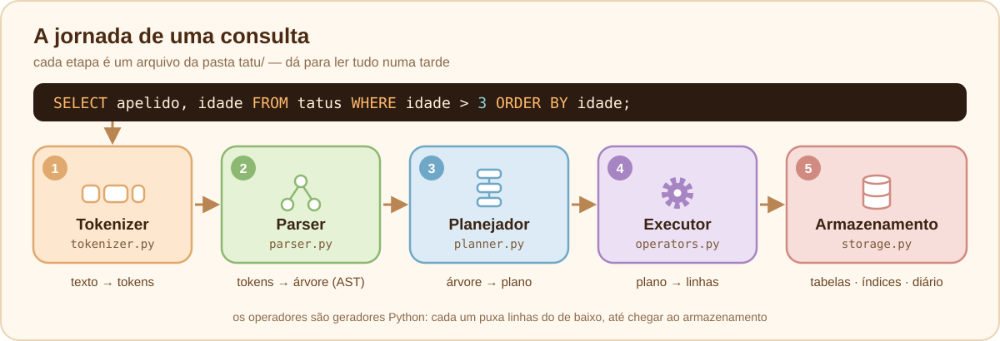
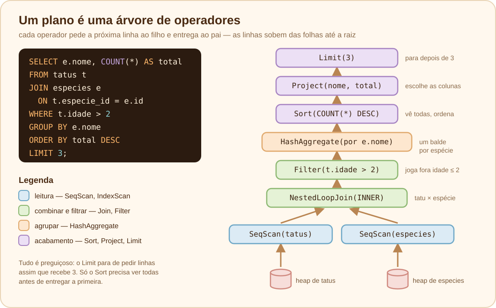

<p align="center">
  
</p>

<p align="center">
  <a href="https://github.com/AlefRP/tatu_db/actions/workflows/ci.yml"></a>
  <a href="https://github.com/AlefRP/tatu_db/releases/latest"></a>
  
  
  
  
  <a href="LICENSE"></a>
</p>

<p align="center">
  <b>Um banco de dados relacional de verdade — tokenizer, parser, planejador, executor, índices e transações —<br>
  em Python puro, sem dependências, com o código comentado em português.</b>
</p>

<p align="center">
  <a href="#-instalação">📦 Instalação</a> ·
  <a href="#-começando">🚀 Começando</a> ·
  <a href="docs/toca.md">🦔 Toca: cliente gráfico</a> ·
  <a href="#-o-sql-que-o-tatu-entende">💬 SQL</a> ·
  <a href="#-por-dentro">🔬 Por dentro</a> ·
  <a href="docs/README.md">📚 Trilha de aprendizado</a> ·
  <a href="docs/09-exercicios.md">🏋️ Exercícios</a> ·
  <a href="CONTRIBUTING.md">🤝 Contribuir</a>
</p>

---

## 🐾 Por que um tatu?

O tatu **cava tocas** e **guarda tudo debaixo de uma armadura feita de faixas**.
Um banco de dados cava o disco, guarda tudo em tabelas feitas de linhas… dá para ver a semelhança. 😄

O **Tatu DB** existe para responder uma pergunta: _o que acontece, de verdade, quando eu digito um `SELECT`?_
Ele é pequeno o bastante para ser lido numa tarde, mas completo o bastante para ter as mesmas
peças de um banco "de gente grande" — cada uma num arquivo, cada uma explicada.

> [!NOTE]
> O Tatu DB é **educacional**. Ele é lento, guarda tudo na memória e não lida com vários usuários ao mesmo tempo.
> Para produção, use SQLite ou PostgreSQL — e use o Tatu para entender como eles funcionam.

## ✨ O que ele sabe fazer

| | Recurso | Exemplo |
|:-:|---|---|
| 🧱 | **Tabelas com tipos** — `INTEGER`, `REAL`, `TEXT`, `BOOLEAN` | `CREATE TABLE tatus (id INTEGER PRIMARY KEY, apelido TEXT)` |
| 🔐 | **Restrições** — `PRIMARY KEY`, `NOT NULL`, `UNIQUE`, `DEFAULT`, `REFERENCES` | `especie_id INTEGER REFERENCES especies(id)` |
| 🔎 | **Consultas** — `WHERE`, `ORDER BY`, `LIMIT/OFFSET`, `DISTINCT` | `SELECT * FROM tatus WHERE idade > 3 ORDER BY idade DESC` |
| 🔗 | **JOINs** — `INNER`, `LEFT`, `CROSS` | `FROM tatus t LEFT JOIN especies e ON t.especie_id = e.id` |
| 📊 | **Agregações** — `COUNT`, `SUM`, `AVG`, `MIN`, `MAX`, `GROUP BY`, `HAVING` | `SELECT bioma, COUNT(*) FROM avistamentos GROUP BY bioma` |
| ⚡ | **Índices hash** — automáticos (PK/UNIQUE) ou com `CREATE INDEX` | `CREATE INDEX idx_idade ON tatus (idade)` |
| 🧭 | **`EXPLAIN`** — mostra a árvore de operadores que vai rodar | `EXPLAIN SELECT * FROM tatus WHERE id = 3` |
| 🔁 | **Transações** — `BEGIN`, `COMMIT`, `ROLLBACK`, com diário de desfazer | `BEGIN; DELETE FROM tatus; ROLLBACK;` |
| 💾 | **Persistência** — um arquivo `.tatu` (JSON legível), gravado de forma atômica | `python -m tatu zoo.tatu` |
| 🛡️ | **Parâmetros `?`** — nada de SQL injection | `db.execute("... WHERE id = ?", (3,))` |
| 🖥️ | **Shell colorido** — tabelas desenhadas, erros com setinha `^` apontando o problema | `.tables`, `.schema`, `.demo` |
| 🦔 | **Toca** — cliente gráfico com editor SQL, tabelas, resultados, estrutura, histórico e transações | `python -m tatu.toca` |

## 🦔 Toca: cliente gráfico

O **Toca** é a interface gráfica própria do Tatu DB, feita em Python com Tkinter. Tem ícone próprio,
temas claro e escuro, editor SQL com cores, navegador de tabelas e grade de resultados.

Na pasta do projeto:

```bash
python -m tatu.toca                  # abre um laboratório de exemplo em memória
python -m tatu.toca zoo.tatu         # abre um banco salvo no computador
```

Depois de instalar esta cópia com `pip install -e .`, também pode usar `toca` ou `toca zoo.tatu`.
**Ctrl+Enter** executa o SQL selecionado, ou todo o editor quando não há seleção.
No computador, bancos salvos em `.tatu` permanecem no disco depois de fechar o aplicativo.



Veja o [guia do Toca](docs/toca.md) para abrir e salvar bancos, usar transações e exportar CSV.
O cliente usa o motor do próprio projeto, com a mesma [referência SQL](docs/08-referencia-sql.md).

## 📦 Instalação

**Baixe o instalador** (versão mais recente, não precisa de Python):

Os instaladores gerados pelo projeto agora incluem o **Tatu DB** e o **Toca**. Abra o cliente pelo
menu de aplicativos ou use `toca`. Os downloads publicados da versão 0.1.0 ainda contêm só o shell;
para gerar o instalador conjunto desta cópia, siga o [guia de construção](docs/instalacao.md#-cliente-gráfico-toca).

| 🪟 Windows | 🍎 macOS | 🐧 Linux |
|:-:|:-:|:-:|
| [**setup.exe**](https://github.com/AlefRP/tatu_db/releases/latest/download/tatu-windows-x86_64-setup.exe) | [**.pkg Apple Silicon**](https://github.com/AlefRP/tatu_db/releases/latest/download/tatu-macos-arm64.pkg) · [**.pkg Intel**](https://github.com/AlefRP/tatu_db/releases/latest/download/tatu-macos-x86_64.pkg) | [**.deb**](https://github.com/AlefRP/tatu_db/releases/latest/download/tatu-linux-x86_64.deb) · [**.rpm**](https://github.com/AlefRP/tatu_db/releases/latest/download/tatu-linux-x86_64.rpm) · [ARM64](docs/instalacao.md#-instaladores) |

**Ou instale pelo terminal**, com uma linha (usa o seu Python se houver; senão, baixa o executável pronto):

| Sistema | Comando |
|---|---|
| 🪟 **Windows** | `irm https://raw.githubusercontent.com/AlefRP/tatu_db/main/scripts/install.ps1 \| iex` |
| 🍎 **macOS** / 🐧 **Linux** | `curl -fsSL https://raw.githubusercontent.com/AlefRP/tatu_db/main/scripts/install.sh \| sh` |
| 🐍 **com pipx** | `pipx install git+https://github.com/AlefRP/tatu_db.git` |

Todas as versões, notas e arquivos (inclusive executáveis portáteis e `SHA256SUMS.txt`) ficam nos
**[Releases](https://github.com/AlefRP/tatu_db/releases)**.

Vai **estudar o código**? Então nem instale — clone e rode direto:

```bash
git clone https://github.com/AlefRP/tatu_db.git && cd tatu_db
python -m tatu
```

Detalhes, opções, desinstalação e soluções para problemas comuns: 📖 [guia de instalação](docs/instalacao.md).

## 🚀 Começando

```bash
tatu                 # banco na memória — ótimo para brincar   (do código-fonte: python -m tatu)
tatu zoo.tatu        # abre (ou cria) um banco gravado em arquivo
```

Dentro do shell, digite `.demo` para carregar espécies de tatu, tatus e avistamentos pelo Brasil:

```text
                 _.-''''''''-._
            _.-''  |  |  |  |  ''-._      __
         .-'   |   |  |  |  |   |   '-.  / /
       .'   |  |   |  |  |  |   |  |   './ /____
      (_____|__|___|__|__|__|___|__|_____)  o   ''-._
  ~~~~~   \__\  \__\          /__/  /__/ '-._______.-'
  Tatu DB 0.1.0 — um banco de dados relacional feito do zero, para aprender.

tatu> .demo
🌵 Pronto! Tabelas criadas: especies, tatus, avistamentos.

tatu> SELECT e.nome AS especie, COUNT(a.id) AS avistamentos
  ..> FROM especies e
  ..> LEFT JOIN tatus t ON t.especie_id = e.id
  ..> LEFT JOIN avistamentos a ON a.tatu_id = t.id
  ..> GROUP BY e.nome
  ..> ORDER BY avistamentos DESC, especie;
╭───────────────────┬──────────────╮
│ especie           │ avistamentos │
├───────────────────┼──────────────┤
│ tatu-bola         │            3 │
│ tatu-galinha      │            3 │
│ tatu-canastra     │            2 │
│ tatu-de-rabo-mole │            1 │
│ tatu-mulita       │            1 │
│ tatu-peba         │            1 │
╰───────────────────┴──────────────╯
6 linhas (0.43 ms)

tatu> EXPLAIN SELECT apelido FROM tatus WHERE especie_id = 2 AND idade > 3;
╭───────────────────────────────────────────────────────────────────╮
│ plano                                                             │
├───────────────────────────────────────────────────────────────────┤
│ Project(apelido)                                                  │
│ └── Filter(idade > 3)                                             │
│     └── IndexScan(tatus usando idx_tatus_especie: especie_id = 2) │
╰───────────────────────────────────────────────────────────────────╯

tatu> INSERT INTO tatus (apelido, especie_id) VALUES ('Perdido', 42);
✖ Restrição violada: REFERENCES violada: não existe especies.id = 42
```

<details>
<summary>⌨️ <b>Comandos do shell</b></summary>

| Comando | O que faz |
|---|---|
| `.help` | mostra a ajuda |
| `.tables` | lista as tabelas, com número de colunas e linhas |
| `.schema [tabela]` | mostra o `CREATE TABLE` (e os índices) |
| `.demo` | carrega os dados de exemplo 🌵 |
| `.read arquivo.sql` | executa um arquivo SQL |
| `.quit` | sai (ou `Ctrl+D` / `Ctrl+Z`) |

Também dá para usar sem o modo interativo:

```bash
tatu zoo.tatu -c "SELECT COUNT(*) FROM tatus"
tatu zoo.tatu < script.sql
```

</details>

## 🐍 Usando no Python

```python
import tatu

db = tatu.connect("zoo.tatu")          # sem argumento: banco só na memória

db.execute("""
    CREATE TABLE tatus (
        id      INTEGER PRIMARY KEY,   -- sem valor? ganha o próximo número
        apelido TEXT NOT NULL,
        idade   INTEGER
    )
""")
db.execute("INSERT INTO tatus (apelido, idade) VALUES (?, ?)", ("Bolinha", 3))
db.execute("INSERT INTO tatus (apelido, idade) VALUES (?, ?)", ("Fuleco", 4))

resultado = db.execute("SELECT apelido, idade FROM tatus WHERE idade > ?", (2,))
print(resultado)                  # desenha a tabela
for apelido, idade in resultado:  # ou percorra as linhas (tuplas)
    print(apelido, idade)

db.execute("SELECT COUNT(*) FROM tatus").scalar()   # → 2
db.execute("SELECT * FROM tatus").as_dicts()        # → [{'id': 1, 'apelido': 'Bolinha', ...}, ...]

try:
    db.execute("INSERT INTO tatus (id, apelido) VALUES (1, 'Clone')")
except tatu.ConstraintError as erro:
    print(erro)                   # PRIMARY KEY violada: já existe tatus.id = 1
```

Um passeio maior está em [`examples/primeiros_passos.py`](examples/primeiros_passos.py).

## 💬 O SQL que o tatu entende

```sql
CREATE TABLE [IF NOT EXISTS] t (col TIPO [PRIMARY KEY] [NOT NULL] [UNIQUE] [DEFAULT v] [REFERENCES t2(col)], ...)
CREATE [UNIQUE] INDEX nome ON t (col)
DROP TABLE [IF EXISTS] t

INSERT INTO t [(col, ...)] VALUES (...), (...)
UPDATE t SET col = expr, ... [WHERE cond]
DELETE FROM t [WHERE cond]

SELECT [DISTINCT] expr [AS apelido], ... | *
  [FROM t [AS a] [[INNER | LEFT | CROSS] JOIN t2 [AS b] ON cond] ...]
  [WHERE cond] [GROUP BY expr, ...] [HAVING cond]
  [ORDER BY expr [ASC | DESC], ...] [LIMIT n [OFFSET m]]

EXPLAIN SELECT ...
BEGIN | COMMIT | ROLLBACK
```

**Operadores:** `+ - * / %` · `||` (concatena) · `= != <> < <= > >=` · `AND OR NOT` · `IS [NOT] NULL` · `[NOT] IN (...)` · `[NOT] BETWEEN` · `[NOT] LIKE`
**Funções:** `UPPER` `LOWER` `LENGTH` `TRIM` `ABS` `ROUND` `COALESCE` `TYPEOF` · **agregações:** `COUNT` `SUM` `AVG` `MIN` `MAX` (com `DISTINCT`)

Tudo detalhado na 📖 [referência do SQL](docs/08-referencia-sql.md).

## 🔬 Por dentro

<p align="center">
  
</p>

Cada etapa é um arquivo de [`tatu/`](tatu/), pensado para ser lido de cima para baixo:

| Etapa | Arquivo | O que acontece |
|---|---|---|
| 🔤 1. Tokenizer | [`tokenizer.py`](tatu/tokenizer.py) | quebra o texto em *tokens*: `SELECT`, `idade`, `>`, `3`… |
| 🌳 2. Parser | [`parser.py`](tatu/parser.py) · [`nodes.py`](tatu/nodes.py) | monta a **árvore sintática** (AST) por descida recursiva |
| 🧭 3. Planejador | [`planner.py`](tatu/planner.py) | transforma a AST num **plano**: uma árvore de operadores, escolhendo índices |
| ⚙️ 4. Executor | [`operators.py`](tatu/operators.py) · [`expressions.py`](tatu/expressions.py) · [`executor.py`](tatu/executor.py) | operadores **Volcano** (geradores Python) puxam linhas; expressões viram funções |
| 💾 5. Armazenamento | [`storage.py`](tatu/storage.py) · [`schema.py`](tatu/schema.py) | heap de linhas, índices hash, diário de desfazer e o arquivo `.tatu` |
| 🔁 Transações | [`database.py`](tatu/database.py) | autocommit, `BEGIN`/`COMMIT`/`ROLLBACK`, atomicidade por comando |

<p align="center">
  
</p>

## 📚 Trilha de aprendizado

A pasta [`docs/`](docs/README.md) conta a história de uma consulta, capítulo por capítulo:

| | Capítulo | Você vai aprender |
|:-:|---|---|
| 🗺️ | [1. A jornada de uma consulta](docs/01-jornada.md) | o caminho completo, do texto até as linhas |
| 🔤 | [2. Tokenizer](docs/02-tokenizer.md) | análise léxica e mensagens de erro com posição |
| 🌳 | [3. Parser e AST](docs/03-parser.md) | gramática, descida recursiva e precedência |
| 🧭 | [4. Planejador e operadores](docs/04-planejador.md) | ordem lógica do SQL, modelo Volcano, índices, `EXPLAIN` |
| 🧮 | [5. Expressões, NULL e agregações](docs/05-expressoes.md) | compilar expressões, lógica de três valores, `GROUP BY` |
| 💾 | [6. Armazenamento: a toca](docs/06-armazenamento.md) | heap, índices hash, restrições, gravação atômica |
| 🔁 | [7. Transações e o diário](docs/07-transacoes.md) | ACID na prática, *undo log*, `ROLLBACK` |
| 📖 | [8. Referência do SQL](docs/08-referencia-sql.md) | tudo o que o Tatu entende |
| 🏋️ | [9. Exercícios](docs/09-exercicios.md) | de `DROP INDEX` a B-tree e WAL — mãos à obra! |

Também na pasta: 📦 [instalação](docs/instalacao.md) · ❓ [perguntas frequentes](docs/faq.md).

## 🗂️ Estrutura do projeto

```text
tatu_db/
├── tatu/                  🐾 o banco de dados
│   ├── tokenizer.py       🔤 texto → tokens
│   ├── parser.py          🌳 tokens → AST
│   ├── nodes.py           🌳 as classes da AST
│   ├── planner.py         🧭 AST → plano
│   ├── operators.py       ⚙️ SeqScan, IndexScan, Filter, Join, Aggregate, Sort...
│   ├── expressions.py     🧮 expressões, NULL, funções e agregações
│   ├── executor.py        🏃 CREATE, INSERT, UPDATE, DELETE e restrições
│   ├── storage.py         💾 heap, índices, diário e arquivo .tatu
│   ├── schema.py          📐 colunas e tabelas
│   ├── datatypes.py       🧱 INTEGER, REAL, TEXT, BOOLEAN
│   ├── database.py        🔁 conexão e transações
│   ├── result.py          📋 resultado e tabelas desenhadas
│   ├── repl.py            🖥️ o shell interativo
│   ├── toca.py            🦔 o cliente gráfico em Tkinter
│   ├── toca_session.py    🧰 sessão, arquivos e resultados do cliente
│   ├── demo.py            🌵 dados de exemplo
│   └── errors.py          🚨 exceções
├── tests/                 🧪 126 testes (unittest)
├── docs/                  📚 trilha de aprendizado, instalação, FAQ e ilustrações
├── examples/              🐍 exemplo de uso pelo Python
├── scripts/               🛠️ instaladores (install.sh, install.ps1), versão, notas e verificador das docs
├── packaging/             📦 executáveis (PyInstaller), setup.exe (Inno Setup), .pkg, .deb, .rpm e ícones
├── .github/               ⚙️ CI, pacotes, nova versão, release, Claude, modelos de issue e PR
├── .claude/               🤖 skills, agentes, hooks e permissões do Claude Code
└── CLAUDE.md              🤖 o "manual do projeto" que o Claude Code lê primeiro
```

## 🧪 Testes e qualidade

```bash
python -m unittest discover -s tests -v    # os testes
ruff check .                               # o linter (pip install ruff)
python scripts/check_docs.py               # links, âncoras, SVGs e números da documentação
```

O [CI](.github/workflows/ci.yml) roda tudo isso a cada push, em **Windows, macOS e Linux, do Python 3.10 ao 3.14**,
testa os dois instaladores de verdade e gera todos os pacotes (`setup.exe`, `.pkg`, `.deb`, `.rpm`, executáveis e wheel).
Uma versão nova sai com um clique: **Actions → Nova versão** (veja o [guia de contribuição](CONTRIBUTING.md#-lançando-uma-versão)).

Os testes também são uma ótima documentação: [`test_queries.py`](tests/test_queries.py) mostra o que cada recurso do SQL faz,
e [`test_transactions.py`](tests/test_transactions.py) mostra o `ROLLBACK` trabalhando.

## 🌱 O que ficou de fora (de propósito)

Para caber numa tarde de leitura, o Tatu simplifica bastante coisa. Cada item abaixo é um ótimo
[exercício](docs/09-exercicios.md):

- 🗃️ os dados vivem **na memória**; o arquivo é regravado inteiro a cada `COMMIT` (bancos reais usam **páginas** e **WAL**);
- 🌲 os índices são **hash** — ótimos para `=`, inúteis para `<` e `>` (bancos reais usam **B-trees**);
- 🔗 o JOIN é sempre por **laços aninhados** (existem *hash join* e *merge join*);
- 👥 **um usuário por vez** — sem controle de concorrência nem isolamento;
- ✂️ sem subconsultas, `ALTER TABLE`, `CASE`, chaves compostas ou views.

## 🤝 Contribuindo

Achou um bug, tem uma ideia ou resolveu um [exercício](docs/09-exercicios.md) e quer compartilhar? Contribuições são
muito bem-vindas! O [guia de contribuição](CONTRIBUTING.md) explica o ambiente, o estilo do código e da documentação,
como gerar os pacotes e como lançar uma versão. Veja também o [código de conduta](CODE_OF_CONDUCT.md)
e o [histórico de mudanças](CHANGELOG.md).

## 🤖 Estudando com o Claude Code

O repositório vem pronto para o [Claude Code](https://claude.com/claude-code): o [`CLAUDE.md`](CLAUDE.md) ensina as
regras do projeto, e a pasta [`.claude/`](.claude/) traz receitas e ajudantes especializados.

| | Nome | Para quê |
|:-:|---|---|
| 🧑‍🏫 | agente **`professor-tatu`** | explica qualquer parte do banco com calma, apontando arquivo e linha |
| 🔍 | agente **`revisor-tatu`** | revisa mudanças: semântica do SQL, `NULL`, diário de desfazer, testes e docs |
| 🧪 | agente **`testador-tatu`** | escreve testes para um recurso novo, caçando os casos de canto |
| 📚 | agente **`guardiao-docs`** | mantém a documentação em dia, rodando cada exemplo citado |
| 🔎 | skill **`/explicar-consulta`** | mostra, passo a passo, como uma consulta SQL é executada |
| ➕ | skill **`/nova-funcao-sql`** | adiciona uma função ou agregação (código, testes e docs) |
| 🧩 | skill **`/novo-comando-sql`** | adiciona um comando ou cláusula atravessando todas as etapas |
| 🎨 | skill **`/ilustracao-svg`** | desenha ilustrações no estilo da documentação |
| 🚀 | skill **`/lancar-versao`** | prepara e publica uma versão nova |

No GitHub, escreva `@claude` numa issue ou PR e o [workflow do Claude](.github/workflows/claude.yml) responde
(precisa configurar o segredo `ANTHROPIC_API_KEY` — veja o [guia de contribuição](CONTRIBUTING.md#-claude-code-no-projeto)).

## 📜 Licença

[MIT](LICENSE) — use, estude, modifique e compartilhe à vontade.

---

<p align="center">
  <br>
  <sub>Feito com 🧡 e muita escavação. Bons estudos!</sub>
</p>
