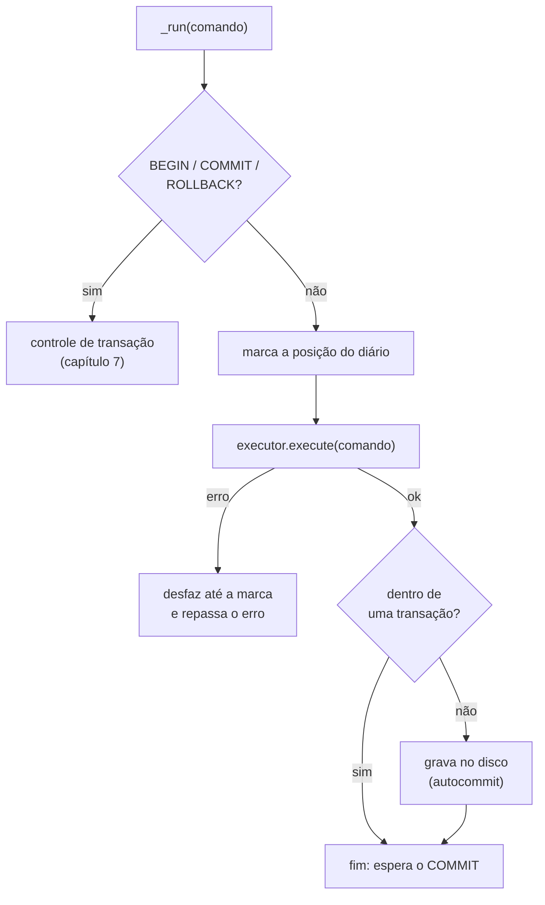

# 🗺️ 1. A jornada de uma consulta

> **Arquivo principal:** [`tatu/database.py`](../tatu/database.py) · [← índice](README.md) · [próximo: Tokenizer →](02-tokenizer.md)


Todo comando que chega ao Tatu passa pelas mesmas etapas. Vamos seguir este aqui:

```sql
SELECT apelido, idade FROM tatus WHERE idade > 3 ORDER BY idade;
```

## 🚪 A porta de entrada: `Database.execute`

Tudo começa em [`database.py`](../tatu/database.py). Simplificando bastante, `execute` faz isto:

```python
def execute(self, sql, params=()):
    stmt = parse(sql)[0]                 # 1-2. tokenizer + parser → AST
    stmt = bind_params(stmt, params)     #      troca cada ? pelo valor
    return self._run(stmt)               # 3-5. planeja, executa, grava
```

E `_run` decide o que fazer com o comando:



## 🧳 A viagem, etapa por etapa

```mermaid
sequenceDiagram
    autonumber
    actor Você
    participant DB as Database
    participant Tok as Tokenizer
    participant Par as Parser
    participant Pla as Planejador
    participant Op as Operadores
    participant St as Armazenamento

    Você->>DB: execute("SELECT apelido, idade FROM tatus ...")
    DB->>Tok: tokenize(texto)
    Tok-->>DB: [SELECT, apelido, ",", idade, FROM, ...]
    DB->>Par: monta a árvore
    Par-->>DB: Select(items=..., from_=TableRef('tatus'), where=...)
    DB->>Pla: plan_select(ast)
    Pla-->>DB: Project ← Sort ← Filter ← SeqScan
    DB->>Op: rows()
    loop uma linha por vez
        Op->>St: próxima linha de tatus
        St-->>Op: (2, 'Canastrão', 3, 7)
    end
    Op-->>DB: linhas prontas
    DB-->>Você: Result(columns, rows)
```

| # | Etapa | Entra | Sai | Capítulo |
|:-:|---|---|---|:-:|
| 1 | 🔤 Tokenizer | `"SELECT apelido, idade FROM ..."` | `[KEYWORD(SELECT), IDENT(apelido), ...]` | [2](02-tokenizer.md) |
| 2 | 🌳 Parser | lista de tokens | `Select(items=..., where=Binary('>', ...))` | [3](03-parser.md) |
| 3 | 🧭 Planejador | AST | árvore de operadores | [4](04-planejador.md) |
| 4 | ⚙️ Execução | plano | linhas (tuplas) | [4](04-planejador.md), [5](05-expressoes.md) |
| 5 | 💾 Armazenamento | pedidos de leitura/escrita | linhas, índices, arquivo | [6](06-armazenamento.md), [7](07-transacoes.md) |

## 👀 Veja com os próprios olhos

Cada etapa pode ser chamada sozinha. Abra o Python na pasta do projeto:

```python
>>> from tatu.tokenizer import tokenize
>>> tokenize("SELECT apelido FROM tatus WHERE idade > 3")
[KEYWORD('SELECT'), IDENT('apelido'), KEYWORD('FROM'), IDENT('tatus'),
 KEYWORD('WHERE'), IDENT('idade'), SYMBOL('>'), NUMBER(3), EOF(None)]

>>> from tatu.parser import parse
>>> parse("SELECT apelido FROM tatus WHERE idade > 3")[0].where
Binary(op='>', left=Column(name='idade', table=None), right=Literal(value=3))

>>> import tatu
>>> from tatu.demo import DEMO_SQL
>>> db = tatu.connect(); _ = db.executescript(DEMO_SQL)
>>> print(db.execute("EXPLAIN SELECT apelido FROM tatus WHERE idade > 3 ORDER BY idade"))
╭────────────────────────────╮
│ plano                      │
├────────────────────────────┤
│ Project(apelido)           │
│ └── Sort(idade)            │
│     └── Filter(idade > 3)  │
│         └── SeqScan(tatus) │
╰────────────────────────────╯
```

> [!NOTE]
> Repare que o plano é lido **de baixo para cima**: primeiro lemos a tabela (`SeqScan`),
> depois filtramos, ordenamos e, por último, escolhemos as colunas. É o contrário da ordem em que
> escrevemos o SQL — o [capítulo 4](04-planejador.md) explica o porquê.

## ✍️ E quando o comando muda dados?

`INSERT`, `UPDATE` e `DELETE` não montam um plano completo: o [`executor.py`](../tatu/executor.py)
cuida deles diretamente. O caminho é:

1. confere tipos e restrições (`NOT NULL`, `REFERENCES`…);
2. pede ao armazenamento para mudar a linha — e o armazenamento **anota no diário** como desfazer a mudança;
3. se nada deu errado e não há transação aberta, o banco é **gravado no disco** (*autocommit*).

Se algo dá errado no meio (por exemplo, a terceira de cinco linhas de um `INSERT` repete uma chave),
o diário desfaz as duas primeiras. **Ou o comando acontece por inteiro, ou não acontece.**

---

<p align="center"><a href="README.md">← índice</a> · <a href="02-tokenizer.md"><b>próximo: 🔤 Tokenizer →</b></a></p>
