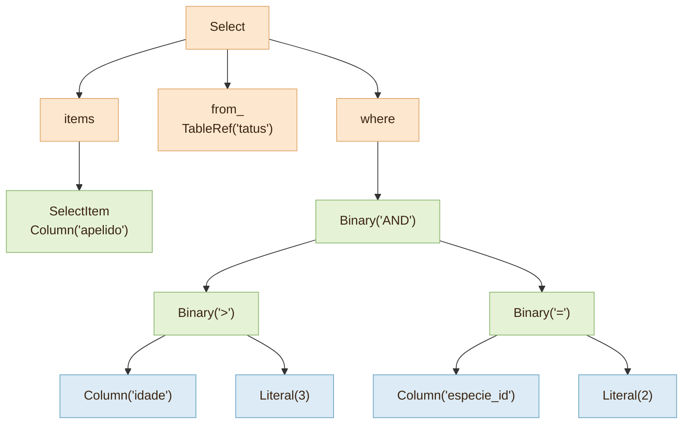

# 🌳 3. Parser e AST: dando sentido às palavras

> **Arquivos:** [`tatu/parser.py`](../tatu/parser.py) · [`tatu/nodes.py`](../tatu/nodes.py) · [← Tokenizer](02-tokenizer.md) · [próximo: Planejador →](04-planejador.md)

O tokenizer entregou palavras soltas. O **parser** (analisador sintático) confere se elas formam uma
frase válida e monta uma **árvore sintática abstrata** — a **AST**.

```sql
SELECT apelido FROM tatus WHERE idade > 3 AND especie_id = 2
```



Daqui em diante, ninguém mais olha para texto: o resto do banco trabalha com esses objetos.

## 🧱 A AST são dataclasses imutáveis

Em [`nodes.py`](../tatu/nodes.py), cada construção do SQL é uma classe:

```python
@dataclass(frozen=True)
class Binary(Node):
    op: str        # "+", "=", "AND"...
    left: Node
    right: Node
```

Por que `frozen=True`? Porque nós imutáveis podem ser **comparados com `==`** e usados **como chave
de dicionário**. Isso parece detalhe, mas o planejador depende disso: em

```sql
SELECT especie_id, COUNT(*) FROM tatus GROUP BY especie_id HAVING COUNT(*) > 1
```

os dois `COUNT(*)` viram objetos `Call('COUNT', star=True)` **iguais** — então o banco calcula a
contagem uma vez só e reaproveita no `HAVING`.

Os nós também sabem se imprimir de volta como SQL (`__str__`), e é por isso que o `EXPLAIN` mostra
`Filter(idade > 3)` em vez de `Filter(Binary(op='>', ...))`.

## ⬇️ Descida recursiva: uma regra, um método

A gramática do SQL é descrita por regras. Uma versão simplificada do `SELECT`:

```text
select      → SELECT [DISTINCT] item ("," item)*
              [FROM tabela join*] [WHERE expr]
              [GROUP BY expr ("," expr)*] [HAVING expr]
              [ORDER BY ordem ("," ordem)*] [LIMIT expr [OFFSET expr]]
item        → "*" | expr [[AS] nome]
join        → [INNER | LEFT [OUTER] | CROSS] JOIN tabela [ON expr]
```

No parser de **descida recursiva**, cada regra vira um método que lê tokens da esquerda para a
direita. A leitura de `select` fica quase igual à gramática:

```python
def select(self):
    self.expect_kw("SELECT")
    distinct = bool(self.accept_kw("DISTINCT"))
    items = [self.select_item()]
    while self.accept_sym(","):
        items.append(self.select_item())
    if self.accept_kw("FROM"):
        from_ = self.table_ref()
        joins = self.joins()
    where = self.expr() if self.accept_kw("WHERE") else None
    ...
```

Três ferramentas fazem quase todo o trabalho:

| Método | Faz o quê | Se não encontrar... |
|---|---|---|
| `check(tipo, valor)` | só **olha** o token atual | devolve `False` |
| `accept(tipo, valor)` | consome o token **se** for o esperado | devolve `None` e segue |
| `expect(tipo, valor)` | consome o token **obrigatório** | lança `TatuSyntaxError` |

## 🪜 Precedência: a escada das expressões

Quanto vale `1 + 2 * 3`? Todo mundo sabe que é 7, e não 9. O parser precisa "saber" disso.
A técnica é uma **escada**: cada degrau trata os operadores de uma força e **chama o degrau de baixo**
para ler os operandos.

```text
expr ─▶ or_expr ─▶ and_expr ─▶ not_expr ─▶ comparison ─▶ additive ─▶ multiplicative ─▶ unary ─▶ primary
         OR          AND          NOT       = < > IS IN     + - ||        * / %            -x      42, nome,
                                            LIKE BETWEEN                                            f(x), (expr)
         ◀──────────── mais fraco ───────────────────────────────────────────── mais forte ────────────▶
```

```python
def additive(self):
    left = self.multiplicative()           # o degrau de baixo lê "1"
    while self.tok.value in ("+", "-", "||"):
        op = self.advance().value
        left = Binary(op, left, self.multiplicative())   # e depois "2 * 3", inteiro
    return left
```

Ao ler `1 + 2 * 3`, `additive` pede um operando a `multiplicative`, que devolve `1`. Vê o `+`, pede outro
operando a `multiplicative` — que lê `2 * 3` **inteiro**, porque `*` é com ele. Resultado:
`Binary('+', 1, Binary('*', 2, 3))`. O `*` ficou mais fundo na árvore, então é calculado primeiro. ✨

> [!TIP]
> O `while` também resolve a **associatividade**: `10 - 3 - 2` vira `(10 - 3) - 2`, porque cada
> nova subtração "embrulha" o resultado anterior pela esquerda.

### 🪤 A pegadinha do `BETWEEN`

```sql
WHERE idade BETWEEN 1 AND 3 AND ativo
```

O primeiro `AND` pertence ao `BETWEEN`; o segundo é o `AND` lógico. Para não confundir, os limites do
`BETWEEN` são lidos com `additive()` — um degrau **abaixo** de `and_expr`, que nunca consome `AND`.

## 💬 Erros de sintaxe amigáveis

Quando `expect` não encontra o que queria, ele diz **o que esperava** e **o que encontrou**, com a setinha:

```text
tatu> SELECT COUNT(* FROM tatus;
✖ Erro de sintaxe: Esperava ')', mas encontrei 'FROM' (linha 1, coluna 16)
  SELECT COUNT(* FROM tatus;
                 ^
```

## 🌲 Passeando pela árvore: `walk` e `transform`

Duas funções genéricas de [`nodes.py`](../tatu/nodes.py) percorrem qualquer AST usando `dataclasses.fields`:

- **`walk(nó)`** visita todos os descendentes. O planejador usa para achar agregações:
  `[n for n in walk(expr) if é_agregação(n)]`.
- **`transform(nó, fn)`** reconstrói a árvore aplicando `fn` em cada nó. É assim que os `?` viram valores:

```python
def substitute(node):
    return Literal(params[node.index]) if isinstance(node, Param) else node

transform(ast, substitute)   # devolve uma árvore NOVA; a antiga não muda
```

> [!IMPORTANT]
> É por isso que parâmetros `?` **impedem SQL injection**: o valor entra na árvore como um `Literal`,
> **depois** do parser. Ele nunca passa pelo tokenizer, então nunca pode virar código SQL.

## 🧪 Experimente

```python
>>> from tatu.parser import parse
>>> stmt = parse("SELECT a FROM t WHERE 1 + 2 * 3 > x")[0]
>>> stmt.where
Binary(op='>', left=Binary(op='+', left=Literal(value=1), right=Binary(op='*', left=Literal(value=2), right=Literal(value=3))), right=Column(name='x', table=None))
>>> print(stmt.where)
1 + 2 * 3 > x
>>> print(parse("SELECT (1 + 2) * 3")[0].items[0].expr)
(1 + 2) * 3
```

## 🏋️ Para praticar

- 🐾 Aceite `IS TRUE` / `IS FALSE` em `comparison()`.
- 🐾🐾 Adicione a expressão `CASE WHEN cond THEN valor ... ELSE valor END` (um novo nó em `nodes.py`,
  um ramo em `primary()` e outro em `compile_expr` no capítulo 5).
- 🐾🐾 Implemente `INSERT INTO t SELECT ...`.

---

<p align="center"><a href="02-tokenizer.md">← Tokenizer</a> · <a href="04-planejador.md"><b>próximo: 🧭 Planejador e operadores →</b></a></p>
