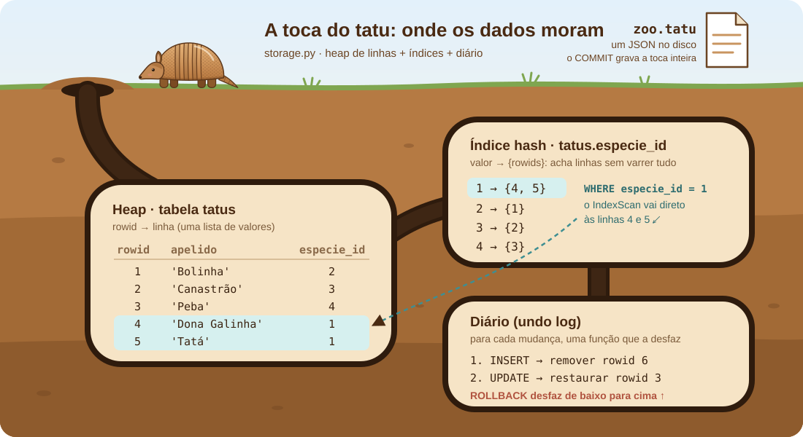
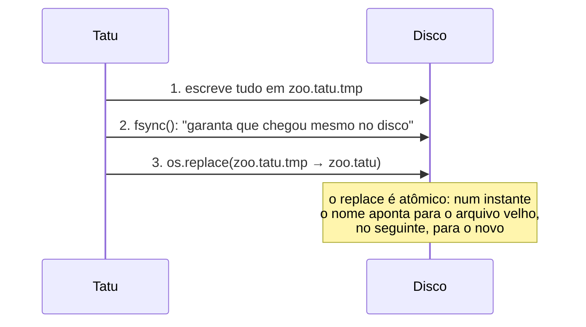

# 💾 6. Armazenamento: a toca

> **Arquivos:** [`tatu/storage.py`](../tatu/storage.py) · [`tatu/schema.py`](../tatu/schema.py) · [`tatu/executor.py`](../tatu/executor.py) · [← Expressões](05-expressoes.md) · [próximo: Transações →](07-transacoes.md)



Toda a conversa até aqui foi sobre **encontrar** dados. Agora vamos ver onde eles **moram**.

## 📋 O heap: um dicionário de linhas

Cada tabela (`Table`) guarda suas linhas num dicionário:

```python
table.rows = {
    1: [1, 'Bolinha',   2, 3],
    2: [2, 'Canastrão', 3, 7],
    3: [3, 'Peba',      4, 2],
    ...
}
```

A chave é o **rowid**: um número interno, único e que nunca se repete (`next_rowid` só cresce).
Ele é diferente da sua chave primária — você pode mudar o `id` de um tatu num `UPDATE`, mas o
rowid daquela linha continua o mesmo. Os índices apontam para rowids.

Por que "heap" (monte)? Porque as linhas ficam **amontoadas, sem ordem** útil. Para achar
alguma coisa, ou você olha tudo (`SeqScan`), ou usa um índice.

## 🔎 Índices hash: atalhos para as linhas

Um índice é um segundo dicionário, que mapeia **valor → conjunto de rowids**:

```python
idx_tatus_especie.entries = {
    1: {4, 5},     # Dona Galinha e Tatá são tatus-galinha
    2: {1, 6},     # Bolinha e Fuleco são tatus-bola
    3: {2},
    ...
}
```

`WHERE especie_id = 1` vira `entries.get(1)` → `{4, 5}` → `rows[4]`, `rows[5]`. Em vez de olhar
todas as linhas, olhamos **duas**. Esse é o poder de um índice — e o seu custo: **toda** mudança na
tabela precisa atualizar **todos** os índices dela. Veja `_put` e `_remove`:

```python
def _put(self, rowid, row):
    self.rows[rowid] = row
    for index in self.indexes.values():
        index.add(row[index.position], rowid)     # mantém os índices em dia
```

> [!NOTE]
> `NULL` **nunca** entra no índice: como `x = NULL` nunca é verdadeiro, ninguém procura por ele.
> E isso tem um efeito bônus: uma coluna `UNIQUE` aceita vários `NULL`s.

## 🔐 Quem cuida de cada restrição?

| Restrição | Onde é verificada | Como |
|---|---|---|
| tipos (`INTEGER`, `TEXT`…) | `executor._validate_row` | `coerce()`: converte sem perda (`3` → `3.0`) ou reclama |
| `NOT NULL` | `executor._validate_row` | valor `None` numa coluna `not_null` → erro |
| `PRIMARY KEY` / `UNIQUE` | `Table._check_unique` | o índice automático já tem esse valor? → erro |
| `REFERENCES` (inserir/alterar) | `executor._validate_row` | o valor existe no índice da tabela "pai"? |
| `REFERENCES` (apagar o pai) | `executor._check_not_referenced` | alguma linha "filha" ainda aponta para ela? → erro |
| `DEFAULT` | `executor.insert` | coluna fora do `INSERT` recebe o valor padrão |

Ponto curioso: **`PRIMARY KEY` e `UNIQUE` são só índices únicos**. Quando a tabela é criada, cada
coluna dessas ganha um índice (`pk_tatus_id`, `uq_especies_nome`), e "impedir repetição" vira
"olhar no dicionário antes de inserir".

Outro: uma `INTEGER PRIMARY KEY` sem valor ganha **o próximo número** (`max + 1`), como no SQLite.
Por isso `INSERT INTO tatus (apelido) VALUES ('Novo')` funciona.

## 📄 O arquivo `.tatu`

O banco inteiro vira um JSON legível. Abra o seu num editor de texto!

```json
{
  "formato": "tatu-db",
  "versao": 1,
  "tabelas": [
    {
      "esquema": {
        "nome": "tatus",
        "colunas": [
          {"nome": "id", "tipo": "INTEGER", "chave_primaria": true},
          {"nome": "apelido", "tipo": "TEXT", "nao_nulo": true},
          {"nome": "especie_id", "tipo": "INTEGER", "referencia": ["especies", "id"]},
          {"nome": "idade", "tipo": "INTEGER"}
        ]
      },
      "proximo_rowid": 10,
      "indices": [{"nome": "idx_tatus_especie", "coluna": "especie_id", "unico": false}],
      "linhas": [
        [1, 1, "Bolinha", 2, 3],
        [2, 2, "Canastrão", 3, 7],
        ...
      ]
    }
  ]
}
```

Cada linha é gravada como `[rowid, valor1, valor2, ...]`. Os índices automáticos não são gravados:
eles são reconstruídos a partir do esquema quando o arquivo é aberto.

## ⚛️ Gravando sem medo: a escrita atômica

E se a luz acabar **no meio** da gravação? Um arquivo pela metade seria um desastre. O truque:



Se a luz acabar no passo 1 ou 2, o `zoo.tatu` antigo está intacto (sobra só um `.tmp`).
Se acabar depois do 3, o novo está completo. **Nunca existe um arquivo meio velho, meio novo.**

## 🏗️ E os bancos de verdade?

O Tatu guarda tudo na memória e regrava o arquivo inteiro a cada mudança — simples, mas impossível
com 100 GB de dados. Os bancos reais:

| No Tatu | Num banco real |
|---|---|
| tudo na memória | dados em **páginas** de tamanho fixo (ex.: 4 KB, 8 KB), lidas sob demanda |
| arquivo regravado inteiro | só as páginas alteradas são escritas |
| escrita atômica do arquivo todo | **WAL** (*write-ahead log*): registra a mudança num log antes de tocar nas páginas |
| índice hash (dicionário) | **B-tree**: árvore ordenada, boa para `=` **e** para `<`, `>`, `BETWEEN`, `ORDER BY` |
| linhas como listas Python | linhas codificadas em bytes dentro das páginas |

Todos esses viram [exercícios](09-exercicios.md) — os mais desafiadores. 🐾🐾🐾

## 🏋️ Para praticar

- 🐾 Implemente `DROP INDEX nome`.
- 🐾🐾 Implemente `ON DELETE CASCADE` em `REFERENCES`.
- 🐾🐾🐾 Troque o JSON por um arquivo binário com páginas de 4 KB.

---

<p align="center"><a href="05-expressoes.md">← Expressões</a> · <a href="07-transacoes.md"><b>próximo: 🔁 Transações e o diário →</b></a></p>
