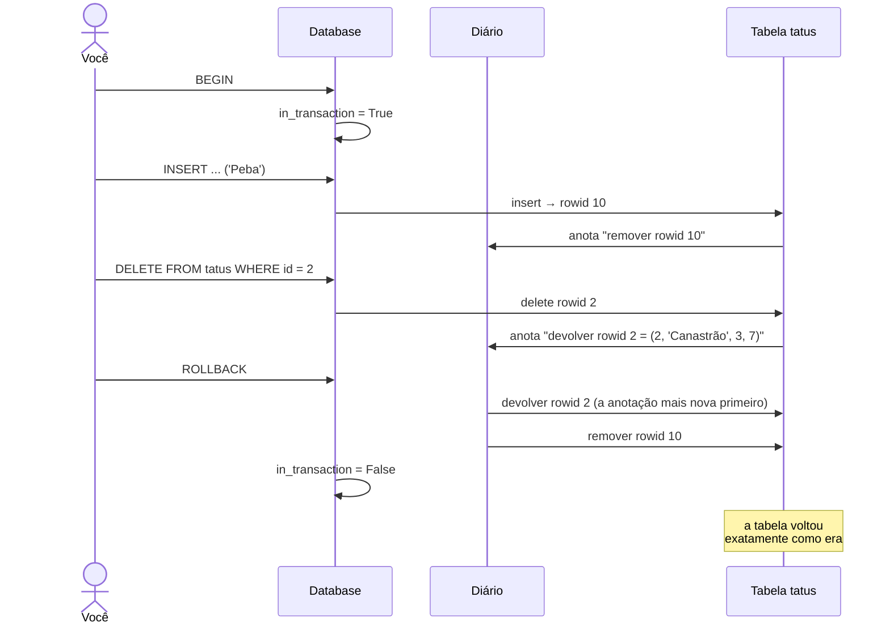

# 🔁 7. Transações e o diário

> **Arquivos:** [`tatu/storage.py`](../tatu/storage.py) (classe `Journal`) · [`tatu/database.py`](../tatu/database.py) · [← Armazenamento](06-armazenamento.md) · [próximo: Referência →](08-referencia-sql.md)

Imagine transferir um tatu de uma toca para outra: tirar da toca A **e** colocar na toca B.
Se o sistema cair entre os dois passos, o tatu some. Uma **transação** garante que um grupo de
mudanças acontece **por inteiro — ou não acontece**.

```sql
BEGIN;
UPDATE tatus SET toca_id = 2 WHERE id = 7;
UPDATE tocas SET moradores = moradores - 1 WHERE id = 1;
UPDATE tocas SET moradores = moradores + 1 WHERE id = 2;
COMMIT;      -- ou ROLLBACK, para desistir de tudo
```

## 📓 O diário de desfazer (undo log)

O segredo do Tatu é uma lista de **funções que desfazem**. Cada mudança no armazenamento anota,
no diário, como voltar atrás:

```python
def insert(self, row):
    rowid = self.next_rowid
    self._put(rowid, row)
    self.journal.record(lambda: self._remove(rowid))      # desfazer = remover

def delete(self, rowid):
    old_row = self._remove(rowid)
    self.journal.record(lambda: self._put(rowid, old_row))  # desfazer = devolver
```

O `lambda` é uma **closure**: ele lembra o `rowid` e a `old_row` daquele momento. Desfazer é chamar
as funções **da mais nova para a mais antiga**:

```python
class Journal:
    def rollback_to(self, mark=0):
        while len(self._undo) > mark:
            self._undo.pop()()          # tira a última função da pilha e chama
```

Por que de trás para frente? Pense em `INSERT` da linha 6 seguido de `UPDATE` da linha 6. Para
voltar ao começo, primeiro desfazemos o `UPDATE`, depois o `INSERT`. É como desempilhar pratos.

Até `CREATE TABLE`, `DROP TABLE` e `CREATE INDEX` são anotados — dá para desfazer um `DROP TABLE`! 😮

## 🎬 Um ROLLBACK em câmera lenta



## 🤖 Autocommit e atomicidade por comando

Fora de um `BEGIN`, cada comando é uma mini-transação (*autocommit*): se deu certo, é gravado no
disco na hora. E **mesmo um comando sozinho** é tudo-ou-nada, graças ao `mark()`:

```python
mark = journal.mark()                  # "marcador de página" antes do comando
try:
    result = self.executor.execute(stmt)
except Exception:
    journal.rollback_to(mark)          # desfaz só o que ESTE comando fez
    raise
```

```text
tatu> INSERT INTO especies (id, nome) VALUES (7, 'a'), (8, 'b'), (7, 'c');
✖ Restrição violada: PRIMARY KEY violada: já existe especies.id = 7
tatu> SELECT COUNT(*) FROM especies WHERE id IN (7, 8);
│        0 │          ← as duas primeiras linhas também foram desfeitas
```

Dentro de uma transação, um comando com erro desfaz **só ele mesmo**; os anteriores continuam valendo
até o `COMMIT` ou o `ROLLBACK`.

## 🧪 ACID: o que o Tatu cumpre (de verdade)

ACID são as quatro promessas clássicas de uma transação. Sendo honestos:

| | Promessa | No Tatu |
|:-:|---|---|
| **A** | **Atomicidade** — tudo ou nada | ✅ o diário desfaz qualquer comando ou transação incompleta |
| **C** | **Consistência** — as regras sempre valem | ✅ tipos, `NOT NULL`, `UNIQUE`, `PRIMARY KEY` e `REFERENCES` são checados a cada mudança |
| **I** | **Isolamento** — transações simultâneas não se atrapalham | ⚠️ não se aplica: o Tatu atende **um** usuário por vez. Dois processos abrindo o mesmo arquivo vão se sobrescrever! |
| **D** | **Durabilidade** — confirmado é para sempre | ✅ o `COMMIT` só termina depois do `fsync` + `os.replace` ([capítulo 6](06-armazenamento.md)) |

> [!NOTE]
> Enquanto a transação está aberta, as mudanças existem **só na memória**. Se o programa fechar sem
> `COMMIT`, nada chega ao disco — e `db.close()` faz um `ROLLBACK` explícito, como o SQLite.

### Undo log × redo log

O Tatu usa um **undo log** (como desfazer) porque as mudanças acontecem direto na memória. Bancos que
gravam páginas no disco costumam usar também um **redo log / WAL** (como refazer): antes de mexer numa
página, escrevem no log o que vão fazer; se caírem, releem o log e refazem o que foi confirmado.
Implementar um WAL é o [exercício](09-exercicios.md) mais nobre desta trilha. 🐾🐾🐾

## 🧪 Experimente

```sql
BEGIN;
DELETE FROM avistamentos;
DROP TABLE avistamentos;
SELECT * FROM avistamentos;        -- erro: a tabela não existe (por enquanto!)
ROLLBACK;
SELECT COUNT(*) FROM avistamentos; -- 12, como se nada tivesse acontecido
```

## 🏋️ Para praticar

- 🐾 Mostre no prompt do shell quando há uma transação aberta: `tatu*>`.
- 🐾🐾 Implemente `SAVEPOINT nome` e `ROLLBACK TO nome` (dica: são só marcas no diário!).
- 🐾🐾🐾 Impeça dois processos de abrirem o mesmo arquivo ao mesmo tempo (um arquivo `.lock`).

---

<p align="center"><a href="06-armazenamento.md">← Armazenamento</a> · <a href="08-referencia-sql.md"><b>próximo: 📖 Referência do SQL →</b></a></p>
