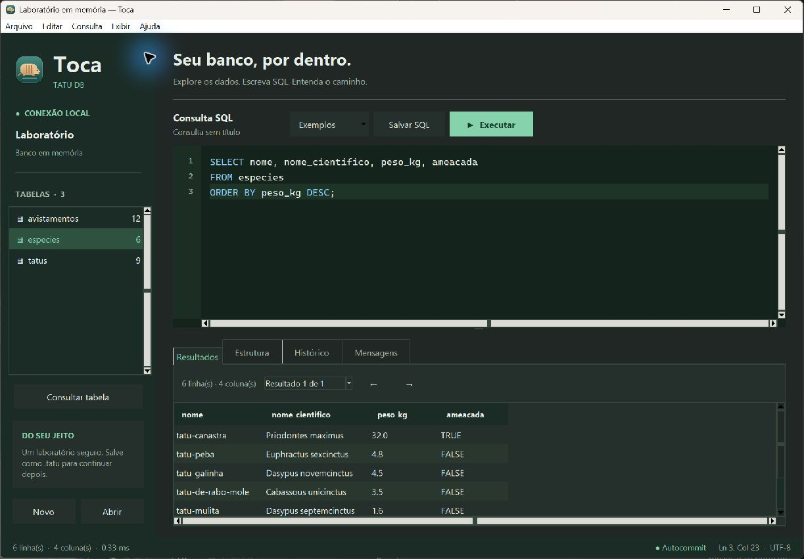

# 🦔 Toca: cliente gráfico do Tatu DB

> [← índice](README.md) · [Instalação](instalacao.md) · [Referência SQL](08-referencia-sql.md)

O **Toca** é o cliente gráfico próprio do Tatu DB: uma janela para escrever SQL, explorar tabelas
e acompanhar resultados. Ele usa o motor Python deste repositório e o formato `.tatu` de sempre.




## 🚀 Abrir

Os instaladores conjuntos incluem o motor e o Toca, com Python e Tcl/Tk incorporados.
No Windows/Linux, abra **Toca** pelo menu de aplicativos; no macOS, abra **Aplicativos → Toca**.
Também pode executar `toca [banco.tatu]`. Veja como instalar ou gerar os pacotes no
[guia de instalação](instalacao.md#-cliente-gráfico-toca).

Na pasta do projeto, com Python 3.10 ou posterior:

```bash
python -m tatu.toca                 # laboratório de exemplo em memória
python -m tatu.toca zoo.tatu        # banco no disco
```

Também pode iniciar com `python -m tatu --gui`. Depois de instalar esta cópia com
`pip install -e .`, há o comando `toca [arquivo.tatu]`.

A interface usa Tkinter, da biblioteca padrão. Confira se seu Python tem suporte a Tcl/Tk com
`python -m tkinter`; veja os detalhes no [guia de instalação](instalacao.md#-cliente-gráfico-toca).

## 🧭 A bancada

| Área | O que fazer |
|---|---|
| Navegador de tabelas | selecione uma tabela para consultar seus dados |
| Editor SQL | escreva consultas, use as cores para reconhecer o SQL e selecione um trecho para executá-lo |
| Resultados | explore a grade com rolagem e copie valores |
| Estrutura | inspecione as colunas, restrições e índices da tabela |
| Histórico | recupere consultas executadas nesta sessão |
| Mensagens | leia o retorno dos comandos e os detalhes de erros |
| Barra de status | acompanhe o banco atual, resultados e estado da transação |

O cliente começa com um laboratório em memória: espécies de tatu, tatus e avistamentos.
Esses dados são didáticos. Use os exemplos para experimentar consultas e `EXPLAIN`.
Os temas claro e escuro mudam a aparência da bancada pelo menu **Exibir**.

Em telas de alta resolução, a janela respeita a escala de fontes do sistema. Maximizar
mantém as colunas em larguras de leitura e amplia a área de resultados; arraste o divisor
para dar mais espaço ao editor quando quiser. No Windows, reabra o Toca depois de mudar
a escala da tela ou passar para um monitor com escala diferente.

## ⌨️ Escrever e executar SQL

**Ctrl+Enter** ou **F5** executa o trecho selecionado. Sem seleção, executa o editor inteiro.
Você pode escrever vários comandos, separados por `;`, e navegar entre os resultados.

O menu **Arquivo** permite abrir e salvar consultas em `.sql`. Salvar uma consulta guarda o texto;
salvar o banco guarda as tabelas e seus dados. A exportação **CSV** grava o resultado da consulta.

| Atalho | Ação |
|---|---|
| Ctrl+Enter / F5 | executar seleção ou editor inteiro |
| Ctrl+N | criar banco |
| Ctrl+O | abrir banco `.tatu` |
| Ctrl+Shift+S | salvar banco como `.tatu` |
| Ctrl+Shift+O | abrir consulta SQL |
| Ctrl+S | salvar consulta SQL |
| Ctrl+A / Ctrl+C / Ctrl+X / Ctrl+V | selecionar, copiar, recortar e colar no editor |

Exemplo para rodar no laboratório:

```sql
SELECT t.apelido, e.nome AS especie
FROM tatus t LEFT JOIN especies e ON t.especie_id = e.id
ORDER BY t.apelido;

EXPLAIN SELECT apelido FROM tatus WHERE especie_id = 2;
```

Se houver um erro, o cliente mostra a mensagem do motor. Em um script, comandos anteriores
podem já ter sido executados e confirmados antes de outro falhar. Use uma transação quando
quiser confirmar ou desfazer um conjunto de alterações.

## 💾 Bancos no computador

Use **Novo banco**, **Abrir banco** e **Salvar banco como** para trabalhar com arquivos `.tatu`.
O laboratório só vive na memória até ser salvo como um arquivo.

No Python, as alterações confirmadas em um banco com caminho são gravadas no disco:
o arquivo permanece depois de fechar o cliente ou reiniciar o computador. Isso difere da
versão do Toca no Capivara OS, cujo sistema de arquivos atual vive na RAM.

O cliente pede confirmação ao trocar ou fechar uma sessão com trabalho pendente.
O motor é educacional e não coordena escritas de vários programas: trabalhe em cada arquivo
por uma conexão de cada vez.

## 🔁 Transações

Os controles no menu **Consulta** usam os mesmos comandos da API e do shell:

```sql
BEGIN;
UPDATE tatus SET idade = idade + 1 WHERE id = 1;
ROLLBACK;
```

Fora de uma transação, cada comando que altera dados é confirmado sozinho (*autocommit*).
Entre `BEGIN` e `COMMIT`, as mudanças ainda podem ser desfeitas com `ROLLBACK`.
Uma transação aberta é desfeita quando a conexão fecha.

Para entender esse mecanismo, leia [Transações e o diário](07-transacoes.md).

## 🔬 Código para estudar

- [`toca.py`](../tatu/toca.py): widgets, editor, cores, menus e atalhos em Tkinter.
- [`toca_session.py`](../tatu/toca_session.py): sessão, execução, arquivos e resultados usados pela interface.
- [`toca_display.py`](../tatu/toca_display.py): medidas e escala de alta resolução.
- [`database.py`](../tatu/database.py): a conexão e as transações do motor.

O SQL disponível é o da [referência do Tatu DB](08-referencia-sql.md).
A interface não muda o parser nem as regras de tipos e restrições.
